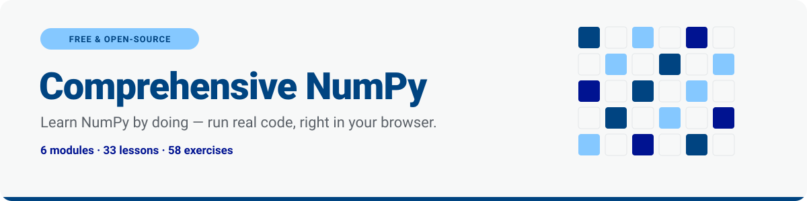

<p align="center">
  <a href="https://numpy.inigoochoa.com">
    
  </a>
</p>

<p align="center">
  <a href="https://numpy.inigoochoa.com"></a>
  <a href="LICENSE"></a>
  
  
</p>

A hands-on, self-paced NumPy course modeled on [StrataScratch's Comprehensive Python](https://www.stratascratch.com/learn/comprehensive-python): short explanations, real example code, and inline coding exercises you can run and check immediately — no video, no paywall, no sign-up.

**Who this is for:** you're comfortable with Python (variables, functions, loops, lists) but new to NumPy.

**Format:** 6 Jupyter notebooks (one per module), 33 lessons, 58 coding exercises. Every exercise runs your code and prints what it actually returns, with a hint and a full solution — both collapsed by default so you're not spoiled unless you ask to be (same idea as the exercise notebooks in Andrew Ng's ML courses).

**Prefer a website?** There's also an interactive, StrataScratch-style course site in [`web/`](web/) — same content, runs real NumPy in the browser via Pyodide, no installs. See [`web/README.md`](web/README.md).

## How to run it

**Locally**

```bash
pip install -r requirements.txt
jupyter notebook   # or: jupyter lab
```

Then open `module_1_fundamentals.ipynb` and work through the modules in order.

**On Google Colab**

Each notebook has an "Open in Colab" badge at the top. It currently points at a placeholder repo path (`YOUR_GH_USERNAME/numpy-course`) — once you push this folder to GitHub, find-and-replace that placeholder in every `.ipynb`'s first cell with your actual `owner/repo`, or regenerate the notebooks after editing the `repo` default in `nb_utils.colab_badge`.

## How each exercise works

Every exercise is the same 5-cell pattern:

1. **Problem statement** — what to implement.
2. **Stub cell** — a function signature with `raise NotImplementedError`. Replace the body with your code.
3. **Check cell** — run it; it prints `✅ PASS` or `❌ FAIL: <reason>`.
4. **💡 Hint** (collapsed) — click to expand if you're stuck.
5. **✅ Solution** (collapsed) — the reference implementation, shown as read-only code so you can compare after you've tried.

## Curriculum

| # | Module | Lessons | Exercises |
|---|---|---|---|
| 1 | [Fundamentals & Array Creation](module_1_fundamentals.ipynb) | 5 | 6 |
| 2 | [Indexing, Slicing & Views](module_2_indexing_views.ipynb) | 5 | 10 |
| 3 | [Array Operations & Broadcasting](module_3_operations_broadcasting.ipynb) | 6 | 12 |
| 4 | [Aggregations, Statistics & Sorting](module_4_aggregations_statistics.ipynb) | 5 | 9 |
| 5 | [Linear Algebra & Random](module_5_linalg_random.ipynb) | 6 | 11 |
| 6 | [Performance, I/O & Mini-Projects](module_6_performance_projects.ipynb) | 6 | 10 |
| | **Total** | **33** | **58** |

**Module 1 — Fundamentals & Array Creation:** `ndarray` vs. Python `list` · creating arrays (`array`/`zeros`/`ones`/`full`/`eye`/`arange`/`linspace`) · shape/dtype/size · reshaping, flattening, transposing · combining & splitting arrays.

**Module 2 — Indexing, Slicing & Views:** basic indexing & slicing · boolean indexing · fancy indexing · views vs. copies (and the mutation gotcha) · `np.newaxis` & `...` (Ellipsis).

**Module 3 — Array Operations & Broadcasting:** ufuncs · the 3 broadcasting rules · vectorization vs. loops · comparison & logical ufuncs · outer/pairwise operations · a loop-to-vectorized case study.

**Module 4 — Aggregations, Statistics & Sorting:** aggregations & the `axis` parameter · `argmin`/`argmax` · sorting · `np.unique` · a multi-step case study analyzing a synthetic daily-temperature series.

**Module 5 — Linear Algebra & Random:** dot products & norms · matrix multiplication · `np.linalg.solve` · eigenvalues · the modern `default_rng` random API · a Monte Carlo estimate of π.

**Module 6 — Performance, I/O & Mini-Projects:** memory layout & strides · vectorization performance patterns · saving/loading arrays · structured arrays · **Capstone 1:** image manipulation on a synthetic grayscale image · **Capstone 2:** analyzing a synthetic stock price series (returns, drawdown, rolling mean) · course wrap-up.

All "real-flavored" data (temperatures, the grayscale image, the stock series) is generated in-notebook with a fixed random seed — nothing to download, works out of the box on Colab.

## Project layout

```
comprehensive-numpy/
├── README.md
├── requirements.txt
├── nb_utils.py              # shared cell-building helpers (markdown/code/exercise blocks)
├── validate_notebook.py     # swaps every exercise stub for its solution and executes the notebook end-to-end
├── build_module_1.py ... build_module_6.py   # generate each .ipynb from code — edit these, not the notebooks, to make changes
├── module_1_fundamentals.ipynb ... module_6_performance_projects.ipynb
├── scripts/convert_notebooks.py   # generates the website in web/ from the notebooks above
└── web/                           # the interactive website (see web/README.md)
```

The notebooks are **generated**, not hand-edited: to change a lesson, edit the corresponding `build_module_N.py` and re-run it, then re-validate:

```bash
python build_module_3.py
python validate_notebook.py module_3_operations_broadcasting.ipynb
```

`validate_notebook.py` checks two things for a module: that the notebook is structurally valid, and that it executes cleanly top-to-bottom once every exercise stub is swapped for its own reference solution — so a broken example or a broken solution fails validation instead of shipping silently.
